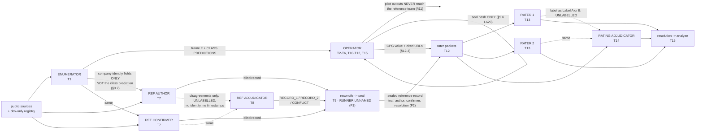
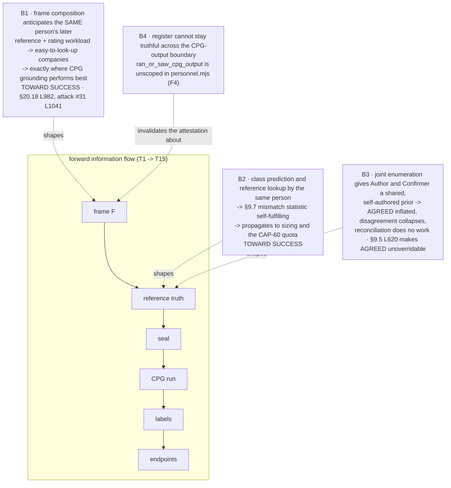

# INFORMATION_FLOW_GRAPH — DEEPTECH-HUMAN-MIN-001 / AGENT E

**CLASSIFICATION: METHODOLOGY REVIEW.** Not U1 evidence. Every "receives" row below is derived from a
protocol clause **and** from the packet builder that constructs it — never from assumption. Where the
text and the builder differ, both are shown and the difference is a finding.

Sources: protocol `c50fc680…` §4A.2, §6.5, §9.1, §9.2, §9.2.1, §11, §12, §12.2, §12.3, §13;
instrument `f7699f05…` `lib/packets.mjs`, `lib/raterPackets.mjs`, `lib/evaluation.mjs`,
`lib/schema.mjs`, `lib/eventlog.mjs`, `lib/reconcile.mjs`, `lib/assignment.mjs`, `lib/ratings.mjs`.

---

## 1. Temporal order of the evidence chain

Order is not a convention here; it is enforced by hashes, by the chain and by the seal. Every
combination verdict in `SAFE_ROLE_COMBINATIONS.md` depends on it.

```mermaid
graph TD
  T1["T1 · ENUMERATION<br/>frame F, class predictions, attestations<br/>§5, §4A.2"]
  T2["T2 · REGISTRATION / FUNDING / COMMITMENT<br/>operator; frame_hash committed before H_rand<br/>§5.5, §19"]
  T3["T3 · DEVELOPMENT DRAW<br/>Bitcoin + drand; §5.5"]
  T4["T4 · PILOT (6 development fill-expected companies)<br/>outputs held by the operator ONLY · §11 L719"]
  T5["T5 · SIZING · person-to-label fingerprint PUBLISHED<br/>before the held-out commitment · §4A.3 L189"]
  T6["T6 · HELD-OUT COMMITMENT + DRAW<br/>ho_record_sha256 comes into existence · §12.1 L752"]
  T7["T7 · BLIND REFERENCE RECORDS<br/>Author and Confirmer, in parallel, no communication · §9.1 L563-564"]
  T8["T8 · REFERENCE ADJUDICATION<br/>disagreements of BOTH stages · §9.2.1 L590, §12.1 L747"]
  T9["T9 · reconcile -> seal -> seal hash PUBLISHED, timestamped<br/>§9.5 L623, §9.6 L627-628"]
  T10["T10 · AUTHORISATION · window opens · §6.5 L452-461"]
  T11["T11 · THE SINGLE AUTHORISED HELD-OUT RUN<br/>one run, never restarted · §6.5 L462-463"]
  T12["T12 · evaluation-items · rater packets<br/>§12.3 L795, evaluation.mjs"]
  T13["T13 · RATING · rater 1 and rater 2, in parallel<br/>§12"]
  T14["T14 · RATING ADJUDICATION<br/>after both sheets submitted · §12.2 L776"]
  T15["T15 · analyze · endpoints · publication · §10, §13.2"]

  T1 --> T2 --> T3 --> T4 --> T5 --> T6 --> T7 --> T8 --> T9 --> T10 --> T11 --> T12 --> T13 --> T14 --> T15
```

**Consequences of the order that no amendment can change.** Reference roles always precede rating
roles (T7–T8 before T13–T14, because the seal at T9 precedes execution at T11). The Author and
Confirmer always precede the reference adjudicator (§9.2.1 L590). Both raters always precede the
rating adjudicator (§12.2 L776). Enumeration always precedes everything. Therefore **every** reference↔rating
overlap, and every observer↔adjudicator overlap, takes exactly one temporal direction; there is no
"safe ordering" variant to choose.

---

## 2. What each role receives — text versus builder

`✔` present · `✘` excluded · quotations are from the protocol; code references are the machine rule.

### 2.1 Enumerator — acts at T1

**Receives (§4A.2 L163–168), exhaustively:** public sources · the frame template · §4A, §5.1–§5.4 ·
the jurisdiction-family list · the development-only registry.

**Never receives (§4A.2 L170):** "pilot results, sizing output, quotas or any CPG output".
Plus §4A.2(b) L158: must "not have run CPG or seen any CPG output (including the development pilot and
instrument check) **before completing the frame**" — note the scope, which `personnel.mjs` does not
reproduce (finding F4 below).

**Produces:** the frame F, including the **class prediction per row** (fill-expected /
abstention-expected) and the admissibility attestations. This output is the root of the whole chain and
is committed by hash at T2.

### 2.2 Operator — acts at T2, T3, T4, T5, T6, T9?, T10, T11, T12, T15

**Receives:** frame and scan (from the enumerator) · sizing · **pilot outputs** (§11 L719, "held by the
operator, never shown to the reference team") · both manifests · **the seal hash only** (§9.6 L629) ·
after T11, the whole archive and every CPG response · the rater sheets at ingestion · every derived
artefact.

**Never receives, before T11:** reference values. §9.6 L629: "The reference file stays with the
reference team until execution and archiving are complete." §18.3 L916 makes a breach a halt condition:
"the operator having seen reference truth. The run is **void, not repaired**."

**T9 is marked `?` deliberately.** The protocol never names who runs `reconcile` and `seal`, and both
consume the three blind-record files. See finding F1.

### 2.3 Reference Author and Confirmer — act at T7, in parallel

**Receive (§9.2 L569), exhaustively:** "company name, canonical domain, jurisdiction family, decisive
identifier, the three field definitions, the value-format rules (§9.3), and the authority table
(§9.4)."

**Never receive (§9.2 L569):** "**CPG output, each other's records, or the class prediction.**"
Plus §9.1 L563–564: no communication before both submit; the Confirmer must not see the Author's record.

**Produce:** one blind record each, `BLIND_RECORD_COLUMNS` (`schema.mjs:201-204`), including
`search_note` (free prose), `recorded_by` and `constructed_without_cpg` which must be `"yes"`
(`schema.mjs:257`, the anti-circularity assertion).

### 2.4 Reference adjudicator — acts at T8

**Receives — the §9.2.1 packet, and the builder makes it exact.** Items carry exactly
`REFERENCE_ITEM_KEYS` (`packets.mjs:12`): `candidate_id`, `field`, `company_name`, `canonical_domain`,
`jurisdiction_family`, `identifier_scheme`, `identifier_value`, `record_1`, `record_2`.

Each record carries exactly `RECORD_KEYS` (`packets.mjs:14`) = `BLIND_RECORD_COLUMNS` **minus**
`candidate_id`, `field`, `recorded_by`, `recorded_at`, `constructed_without_cpg` — i.e. `value_kind`,
`expected_value`, `authoritative_source_name`, `source_class`, `source_url`, `publication_date`,
`as_of_date`, `search_note`. **No recorder identity and no timestamps**, matching §9.2.1 L576 ("each
carrying only its value, source and search content").

**Never receives (§9.2.1 L582–588):** any CPG output including pilot and instrument check · class
predictions, identity-hazard notes, stratum or split · screening logs, attestations, contamination
bases · **agreeing records** (`packets.mjs:31` drops them) · the identities or pseudonyms of Author and
Confirmer · **any count or tally of adjudication outcomes**.

**Position blinding:** Record 1 is the Author's iff the first hex digit of
`order_key("reference-adjudicator-record-1", …)` is even (§9.2.1 L578, `packets.mjs:34`). Decisions are
`RECORD_1` / `RECORD_2` / `REFERENCE-CONFLICT`, mapped mechanically afterwards (`packets.mjs:61-69`) —
there is no mapping file to trust.

### 2.5 Rater 1 and Rater 2 — act at T13, in parallel

**Receive (§12 L727):** "Field; CPG's value or null; the source URLs CPG cited for that value (§12.3);
**the sealed reference record**." The builder: items carry exactly `EVALUATION_ITEM_KEYS`
(`packets.mjs:15`) = `candidate_id`, `field`, `cpg_value`, `cpg_source_urls`, `reference_record`, and
`raterPackets.mjs:60` requires `reference_record` to be **exactly `REFERENCE_COLUMNS`**. Packet header
adds `label`, `cited_url_rule`, `held_out_record_sha256`, `seal_hash`, `evaluation_sha256`,
`item_count`, and per item `position` + `order_key` (`raterPackets.mjs:74-77`).

**Never receive:** the other rater's labels, running tallies or aggregates, the development pilot
(§12 L728); class, split, pilot or rater information (`raterPackets.mjs:55` refuses any extra key).

**What the sealed reference record actually contains** — `REFERENCE_COLUMNS`, `schema.mjs:213-217`:

`candidate_id` · `field` · `value_kind` · `expected_value` · `authoritative_source_name` ·
`source_class` · `source_url` · `publication_date` · `as_of_date` · **`search_note`** ·
`ambiguity_flag` · `independence_class` · **`author`** · **`confirmer`** · **`resolution`** ·
**`adjudicated_by`**

The last four are populated at `reconcile.mjs:72` from each blind record's `recorded_by` and from the
adjudication outcome. See finding F2 — this is the most consequential single row in this document.

### 2.6 Rating adjudicator — acts at T14

**Receives (§12.2 L759–764):** "the identical §12 rater packet" · the §10.1 procedure and §10.2 rules ·
"the two raters' labels shown **unlabelled** as 'Label A' and 'Label B'". Builder: exactly
`RATING_ITEM_KEYS` (`packets.mjs:16`) = `EVALUATION_ITEM_KEYS` + `label_a` + `label_b`.

**Never receives (§12.2 L768–774):** which rater gave which label, or rater identities · other
observations' labels · tallies, aggregates or provisional endpoint values · class prediction, stratum,
split or identity-hazard note · pilot outputs · **the number of disagreements**.

Pending and agreeing items never reach the packet (`packets.mjs:81-82`). Position: Label A is rater 1's
iff the first hex digit of `order_key("rating-adjudicator-label-a", …)` is even (L764,
`packets.mjs:83`).

§12.2 L778 states the residual honestly: "**What cannot be hidden:** U1 is single-arm, so the company
and the CPG output for the item are necessarily visible, and no arm identity exists."

---

## 3. Findings from comparing text against builder

**F1 — `reconcile` / `seal` have no named runner.** Both consume the three blind-record files. §9.5
L623 and §9.6 L627 name the *commands*, never the *person*. If the operator runs them the operator sees
reference truth before the seal, which §9.6 L629/L631 asserts is impossible and §18.3 L916 makes a
void-the-run halt condition. **Unassigned step with a void-level consequence.**

**F2 — the rater packet leaks the reference team's pseudonyms and each row's contest status.** Because
`raterPackets.mjs:60` requires the full `REFERENCE_COLUMNS`, every rater and the rating adjudicator
receive `author`, `confirmer`, `resolution` and `adjudicated_by`. §12 L728's blinding list does not
cover this, so it is not a violation — but nothing authorises it either. Effects:

- *seven-person design:* raters learn who the reference people were and which rows the reference pair
  disagreed on. Gratuitous; no endpoint depends on it.
- *any merged design:* it becomes a **self-identification channel**. A rater who was Author reads
  `author: <own pseudonym>` and `resolution` on every row and needs no memory at all to know whether
  the sealed reference is their own record and whether their value beat their colleague's.

**F3 — "the number of disagreements" cannot be withheld from the rating adjudicator.** §12.2 L774 lists
it among what the adjudicator never receives, yet the packet *is* the list of disagreeing items
(`packets.mjs:86` returns `{schema, items}`), and its length is that number. The rater packet carries
an explicit `item_count`; the adjudication packets do not — but counting one's own worklist is
unavoidable. Head-count-independent over-claim; a nuisance, not a defect, and worth softening in text.

**F4 — `personnel.mjs` cannot express the scope §4A.2(b) states.** `DECLARATION_KEYS`
(`personnel.mjs:8-12`) includes `ran_or_saw_cpg_output`, required `"no"` (line 37), applied per the
line-7 comment "for enumerators **and all roles alike**". §4A.2(b) L158 scopes it "before completing
the frame"; the machine does not. Strictly, **no rater can truthfully answer `"no"` after rating**,
because rating consists of reading CPG output. Tolerable in the seven-person design, where the register
is fixed once and early (before the held-out commitment, §4A.3 L189); **structural in any design where
one person's roles span the CPG-output boundary.**

**F5 — §6.5's "reading" limb catches the study's own downstream artefacts.** §6.5 L466 prohibits "any
reading of stored CPG output (logs, persisted results)" for a frame company by study personnel, and
L471(a) fixes the held-out window as "before the authorised run starts, **or after it completes**". The
rating stage, the rating adjudication, `evaluation-items`, `rater-packet`, `analyze`, the §13.1 archive
and the §13.2-published CPG response set all fall inside that. §6.5 L497: "**The study is VOID**, not
flagged." The intended reading must exclude the protocol's own artefacts; the text does not say so.

---

## 4. Edges created by combining two roles

### 4.1 The graph in the seven-person design

Solid edges are authorised information flow. Dotted edges are **blinded** flows: the content passes,
the authorship does not.

### 4.2 New edges from merging two roles, classified

A "new edge" is what the single person knows **at the moment they perform the later role** that the
protocol withholds from that role. Classification: **HARMLESS** — nothing the later role's rules
exclude, and no self-review · **CONTAMINATING** — the later act is influenced by excluded knowledge,
degrading a measurement · **DISQUALIFYING** — the later act reviews the person's own earlier work, or
the control is the existence of two things one person cannot produce.

| Merge (earlier → later) | New edge created | Class | Reason |
|---|---|---|---|
| **A → C** (one person) | none — the second record simply does not exist | **DISQUALIFYING** | Two constructions is the control. Self-agreement makes every row `AGREED`, and §9.5 L620 forbids overriding `AGREED`. `reconcile.mjs:52` refuses. |
| **A → RA**, **C → RA** | own record body → the "unlabelled" Record 1/2 blind | **DISQUALIFYING** | Recognised by its own `search_note` and `source_url`; the other identified by elimination. The blind *is* the control. No reverse order exists (§9.2.1 L590). `reconcile.mjs:59-60`. |
| **R1 → R2** (one person) | the same item seen twice, in two derived orders | **DISQUALIFYING** | §12 L731 requires "≥ 2 **independent** ratings"; α becomes intra-rater, and the §15.5(3) α gate is passed trivially. `ratings.mjs:97`. |
| **R1 → TA**, **R2 → TA** | own label → the "unlabelled" Label A/B blind | **DISQUALIFYING** | Seven labels and one's own decision in memory: self-identification is near-certain, and every disagreement resolves for the rater-adjudicator — biasing the endpoint by the whole disagreement mass. `ratings.mjs:98`. |
| **EN → A**, **EN → C** | own class prediction → own reference lookup | **DISQUALIFYING** | §9.2 L569 excludes the class prediction from the reference packet; the enumerator *wrote* it. §9.7 L635 publishes reference-vs-prediction mismatch, so one person sits on both sides of a published statistic. X4's own rationale, applied to the roles X4 does not name (INFERENCE E-1). |
| **EN → RA** | own class prediction → contested-value decisions | **DISQUALIFYING** | Named in text: §4A.3 L187. `role_conflict_check.mjs` checks it separately. |
| **A/C/RA → R1/R2** | **no information edge** (the rater receives the sealed reference row by design, §12 L727) — a **motivational** edge only, acting through D1/D2/D3 | **CONTAMINATING** (conservative) | Suppression of REFERENCE-AMBIGUOUS / REFERENCE-STALE. Direction runs predominantly **against** SUCCESS (`INDEPENDENCE_ANALYSIS.md` §2.3): P1 ↑, P2 ↓, P3 risk ↑. Disqualifying for a FAILURE/FALSIFIED finding, tolerable for a SUCCESS if declared. F2 makes the stake explicit rather than remembered. |
| **A/C/RA → TA** | as above, plus the adjudicator rules on REFERENCE-AMBIGUOUS disagreements about reference truth they produced | **CONTAMINATING** (worst of its class) | Same argument, but the disputed axis is frequently the adequacy of the reference itself, which is the person's own earlier work. |
| **EN → R1/R2/TA** | frame membership, class prediction and identity-hazard context → an act the packets blind to class and split (`raterPackets.mjs:55`, §12.2 L772) | **CONTAMINATING** | The person carries in memory what the packet is built to exclude. Company recognition alone is a nuisance (§12.2 L778 concedes it). **Plus edge B1** below, which is the dangerous part. |
| **R/TA → EN** (reverse) | CPG output for ~60 companies → frame construction | **DISQUALIFYING** and temporally impossible | §4A.2(b) L158 forbids an enumerator who has seen CPG output before completing the frame; a frame built afterwards is attack #31 L1041 / §20.18 L982 exactly. **The clearest order asymmetry in the design.** |
| **OP → any** | keys, timing, pilot outputs, archive, plus a judgement act | **DISQUALIFYING** | §4A.3 L184. For reference roles specifically, §18.3 L916 voids the run: "the operator having seen reference truth". |

### 4.3 Backward edges: anticipation, which no ordering fixes

The classification above is about *knowledge at the moment of acting*. Two edges run the other way —
an earlier artefact shaped by the person's anticipation of their own later role. These are the edges a
"forward-only" argument misses, and they are the ones that bias **toward** SUCCESS.

**B1 is the most damaging finding in this document.** A person who knows they will personally
hand-construct reference truth for every drawn company and then rate every held-out observation has a
workload incentive to enumerate companies that are easy to look up — registry-rich, single-jurisdiction,
unambiguous identity. Those are exactly the companies where CPG's registry and Wikidata grounding
performs best. §20.18 L982 already concedes that "Cryptographic sampling integrity ... is **not**
independent candidate selection ... the latter rests on enumerator independence only", and attack #31
L1041 classes frame bias as **UNRESOLVED**. Anticipation travels backwards through time, so no
ordering rule touches B1; only separating the enumerator from the downstream workload does.

---

## 5. What blinding survives, precisely

| Mechanism | Survives two humans? | Why |
|---|---|---|
| Record 1/2 and Label A/B **position** derived from `ho_record_sha256` (§12.1 L745; `packets.mjs:34,83`) | **Unguessable in advance — yes. Unrecognisable afterwards — no.** | L752: `ho_record_sha256` "cannot be known before the held-out drand round exists", so nobody chooses the position. But a participant who authored one item identifies it by content and the other by elimination. **Position blinding protects a third party's ignorance of authorship; it cannot protect a participant's ignorance of their own.** |
| Exclusion of `recorded_by` / `recorded_at` from adjudicator records (`packets.mjs:14`) | **No** | Removes the *label*, not the *recognisability*. `search_note` is free prose the recorder wrote; `source_url` is the URL they chose. |
| Exclusion of agreeing records and agreeing/pending labels (`packets.mjs:31,81-82`) | **Yes** | Purely structural; independent of who holds which role. |
| Deterministic rebuild of every packet (`packets.mjs:55-56,98-99`; `verifyRaterPacket`) | **Yes, but it checks the artefact only** | §9.2.1 L592 says so outright: "What the adjudicator learns outside the packet is controlled procedurally (§4A)." Under a merge the rebuild still passes byte-identically while the human is un-blinded by memory. |
| Rater blinding to each other's labels, tallies, aggregates, pilot (§12 L728) | **No** if one person holds both rater slots; **yes** across two distinct raters regardless of their other roles | The packets carry no cross-rater information; only shared identity defeats it. |
| Exclusion of class, split and pilot from rater and adjudication packets (`raterPackets.mjs:55`, §12.2 L772) | **No** where the person was the enumerator | Carried in memory. Mechanically unreachable. |
| **Non-leak worth recording:** reference truth is sealed at T9, before the run at T11, so no reference observer can ever have seen CPG output when writing their record | **Yes — ordering guarantees it** | This is why §9.8's SOURCE-COINCIDENT cap stays meaningful under any merge (see `OUTSIDER_VERIFIABILITY_DELTA.md` §2). |

**Recognition: disqualifying, or nuisance?** Recognition is a **nuisance** where the later act does not
judge the earlier work, and **disqualifying** where it does. §12.2 L778 already places company
recognition in the nuisance category. The disqualifying cases are exactly the two blinds whose purpose
is to stop an adjudicator knowing whose work is whose: Record 1/2 (A/C → RA) and Label A/B (R → TA).

---

*AGENT E, DEEPTECH-HUMAN-MIN-001. Methodology review. `research/cpg-u1/**` and `C:/tmp/dt002`
unmodified.*
