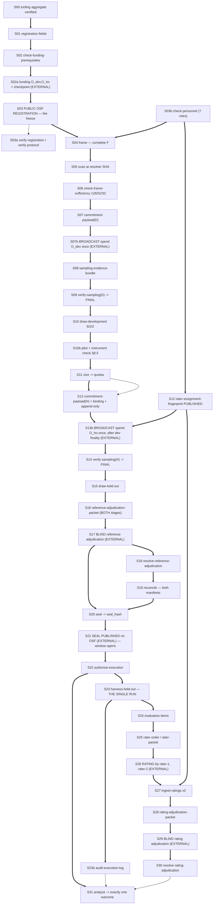

# REGISTRATION_TO_EXECUTION_DAG

DEEPTECH-PARALLEL-010 · STREAM A · dry-run trace of the registration-to-execution sequence.

**THIS DOCUMENT IS NOT EVIDENCE.** It is a preparation artefact. Nothing here was executed, registered,
broadcast, funded, published or committed. No U1 act has been performed. No frame exists. No Bitcoin
transaction, key, OSF record, drand query or network call was made. The document records what the frozen
protocol and the candidate instrument *would* require, read from files; it attests to nothing about the study.

## 0. Provenance of what was read

| Object | Value | How established |
|---|---|---|
| Frozen protocol | `C:/tmp/dt002/research/cpg-u1/CPG_U1_PROTOCOL_004.md` (1104 lines read in part) | read directly |
| Protocol sha256 (briefed) | `c50fc68010fdf29a9439faa3654ef4b6763f0efead99fb6395f2c691df00b719` | **EXTERNAL INPUT REQUIRED** — briefed by caller, not recomputed (no aggregate recomputation permitted this run) |
| Candidate instrument | `C:/tmp/dt009-merge/tooling`, `TOOL_VERSION = 'cpg-u1-data-tooling-6'` (`cpg_u1_data.mjs:47`) | read directly, never modified |
| Instrument aggregate (briefed) | `638d68e6085d6894355a6d14ff2628a2e94c657c795a3d795500dbb3fa278fd2`, 594 files | **EXTERNAL INPUT REQUIRED** — briefed, not recomputed |
| Treatment / evaluation tree (briefed) | commit `f01a7eb4199be4e04d4fee7fc0116303949dc553`, tree `3b4811fc88e9fbb64ee42c37c4aacca2e76c67af`, content aggregate `ffe4f6035333e2ec963d02ccfc0cff39bb28b27ebb3600d56b42bb94c601d1c5` (11552 files) | **VERIFIED as declared text** at protocol §7.1 (all three values appear verbatim); the clone itself was not scanned or hashed |
| Development registry (briefed) | `a1392952627145d049edf82912f410355bc25ce5b087bfdddc30cc91e2a70814` | **EXTERNAL INPUT REQUIRED** — briefed, not recomputed |
| Stale tree to avoid | worktree-local `research/cpg-u1/tooling` (587 files, `640510…`) | **not read**, per directive |

## 1. Step count — a discrepancy, reported not resolved

The directive says **30** steps. The instrument's own pipeline comment (`cpg_u1_data.mjs:3–10`) enumerates
**31** arrow-separated tokens from `registration-fields` to `analyze`. Adding the directive's stated starting
point ("final tooling aggregate certified") gives **32** rows.

This trace therefore carries **32 rows, S00–S31**. Nothing was dropped or invented to reach 30. If exactly 30
rows are required, the two defensible folds are:

- **Fold A**: S08 `sampling-evidence-bundle` into S09 `verify-sampling(D)` — justified, because
  `cmdSamplingEvidenceBundle` already calls `evaluate(...)` for both stages and prints each stage's state
  before writing the bundle (`cpg_u1_data.mjs:1104–1113`); the bundle command *is* a verification.
- **Fold B**: S21 `[seal published]` into S20 `seal` — **NOT recommended**; they are different actors (reference
  team vs. registry) and the registry timestamp is the thing that opens the execution window
  (`lib/execution.mjs:79` `window_opens_at: sealPublication.registry_timestamp`). Folding it hides an
  authorization point.

Marking convention: **VERIFIED** = read in the protocol or the instrument's code, with citation.
**PREPARED** = this stream's synthesis over verified parts. **EXTERNAL INPUT REQUIRED** = the step cannot be
characterised from the protocol or the instrument; a human, a registry, a chain or a relay supplies it.

## 2. The 32-row trace

Columns: **Actor** · **Required input** · **Produced artifact** · **Hash / fingerprint** · **Prerequisite** ·
**Rev?** (reversible) · **Pub?** (public) · **Ev?** (evidence-bearing) · **Auth?** (human authorization required) ·
**Status**.

### S00 — final tooling aggregate certified

| Field | Value |
|---|---|
| Actor | instrument owner (not a §4A role; the developing organisation may do this — the tooling is the *instrument*, not the treatment, §7.1 "What the tree is not") |
| Required input | the complete tooling tree, every file, vendored dependencies included |
| Produced artifact | the aggregate value itself (no file); `lib/aggregate.mjs` `toolingManifest()` |
| Hash | `sha256` over `"<sha256>  <path>\n"` lines, sorted by path, LF-terminated — `lib/aggregate.mjs:8–24`; briefed value `638d68e6…`, 594 files |
| Prerequisite | none inside the sequence. Symlinks and non-regular entries are refused (`lib/aggregate.mjs:14–15`) |
| Rev? | **Yes, until S07.** Freely re-certifiable before registration. After S07 it is the first one-way door |
| Pub? | Yes — it goes into the public registration (§5.5.1 Content) |
| Ev? | Yes — it is a registration sampling field |
| Auth? | No |
| Status | **VERIFIED** (definition and enforcement); aggregate *value* EXTERNAL INPUT REQUIRED |

### S01 — `registration-fields`

| Field | Value |
|---|---|
| Actor | operator (`STUDY_OPERATOR`) or instrument owner |
| Required input | `--protocol`, `--registry`, `--out`; the tooling tree at `ROOT` |
| Produced artifact | registration template JSON, every identity `UNASSIGNED` (`cpg_u1_data.mjs:306–311`; `lib/registration.mjs:34–56`) |
| Hash | writes `protocol_sha256`, `tooling_aggregate_sha256` (computed here: `toolingManifest(ROOT).aggregate`), `registry_sha256` |
| Prerequisite | S00 |
| Rev? | **Yes** — regenerate freely; `writeOnce` refuses overwrite of the same path, but a new path is permitted |
| Pub? | Not yet; its content becomes public at S07 |
| Ev? | Pre-evidence |
| Auth? | No |
| Status | **VERIFIED** |

### S02 — `check-funding-prerequisites`

| Field | Value |
|---|---|
| Actor | operator |
| Required input | `--registration` (with `bitcoin_key_custodian.value` named) |
| Produced artifact | console attestation only; no file (`cpg_u1_data.mjs:313–318`) |
| Hash | none |
| Prerequisite | S01 + the custodian named. Phase `'funding'` checks only the custodian and the pinned parameters (`lib/registration.mjs:92`) — measured: **1 blocker** when unnamed |
| Rev? | Yes |
| Pub? | No |
| Ev? | No |
| Auth? | **Yes — §19.3(2)**: a named human must be the Bitcoin wallet-key custodian, role `STUDY_OPERATOR` |
| Status | **VERIFIED** |

### S02a — funding + checkpoint (the directive's pipeline does not list this; §5.5 step 0–1 does)

| Field | Value |
|---|---|
| Actor | key custodian (operator), **outside the tooling** |
| Required input | a Bitcoin mainnet wallet |
| Produced artifact | two distinct single-signature P2WPKH outputs `O_dev`, `O_ho`; a checkpoint (height, hash) at or after both funding confirmations |
| Hash | outpoints; checkpoint hash |
| Prerequisite | S02. `funding_height + 6 − 1 ≤ checkpoint_height` [enforced] (§5.5.2) |
| Rev? | **No, in effect.** Each outpoint can be spent once; loss of the key means abandonment (§5.5.2). A spend at or before the checkpoint → `STUDY_VOID_PRE_REGISTRATION_SPEND` (§5.10; `lib/sampling.mjs:130`) |
| Pub? | Yes (registered) |
| Ev? | Yes |
| Auth? | **Yes** — the custodian acts |
| Status | **VERIFIED** as protocol requirement; the act itself is **EXTERNAL INPUT REQUIRED**. *Row included because the pipeline comment omits it and the DAG needs it; it is not one of the directive's numbered steps.* |

### S03 — `[registration]` — the freeze

| Field | Value |
|---|---|
| Actor | **accountable identity**, on OSF Registries, public, no embargo (§5.5.1) |
| Required input | completed registration record: protocol sha, **tooling aggregate sha**, registry sha, accountable identity, persistent identifier, custodian, network `bitcoin-mainnet`, `O_dev`/`O_ho`, checkpoint, pinned parameters, `as_of`, `provider_configuration_sha256`, authority rule, §21 procedure |
| Produced artifact | the public registration record |
| Hash | registry-issued `registration_id` + `registration_timestamp` — **never asserted by the operator** (§5.5.1 "Registry-issued") |
| Prerequisite | S00–S02a. Ordering is normative: funding confirmed → registration → frame construction → development commitment (§5.5.1 "Ordering") |
| Rev? | **NO — one-way door #1.** A second registration with different sampling fields → study VOID; a withdrawal → study VOID (`lib/registration.mjs:119` `SAMPLING_FIELDS`, `checkAuthority`) |
| Pub? | **Yes, mandatorily.** Embargo/private forbidden |
| Ev? | Yes — "Only a study registered under the accountable identity may be reported as CPG U1 evidence" |
| Auth? | **Yes — §19.3(1)**: accountable OSF identity + persistent identifier, both UNASSIGNED in protocol and template |
| Status | **VERIFIED** (rule); act **EXTERNAL INPUT REQUIRED** |

### S03a — `verify-registration` / `verify-protocol` (gate, §21 step 2)

| Field | Value |
|---|---|
| Actor | outsider verifier, or operator self-check |
| Required input | `--registration`, `--protocol`, `--registry`, `--identity-registrations`, optionally `--evidence` |
| Produced artifact | console verdict; exit code |
| Hash | compares `protocol_sha256`, tooling aggregate (recomputed from `ROOT`), `registry_sha256` (`cpg_u1_data.mjs:174–184`, 334–344) |
| Prerequisite | S03 |
| Rev? | Yes (read-only) |
| Pub? | Its inputs are |
| Ev? | Yes — it is §21's own step |
| Auth? | No |
| Status | **VERIFIED.** *Current state measured:* on the template, `checkRegistration(phase:'registered')` returns **0 errors and 10 blockers** → `reportRegistrationCheck` fails with `EXIT.BLOCKED = 4` (`cpg_u1_data.mjs:163–168`). See §5 "Contradictions" on the briefed count of nine. |

### S04 — `frame`

| Field | Value |
|---|---|
| Actor | **enumerator(s)** build the frame CSV; the operator may run the command |
| Required input | `--frame` (CSV, exactly `FRAME_COLUMNS`), `--personnel` |
| Produced artifact | console tally + refusal; the frame CSV is the artifact (no new file written) |
| Hash | `frame_hash = hashRecords(frame, 'candidate_id')`, which **binds `enumerated_by`** because it is one of `FRAME_COLUMNS` (`cpg_u1_data.mjs:220–224`) |
| Prerequisite | S03 (registration precedes frame construction) + S03b personnel. `checkEnumerationAttribution` refuses any row not attributed to a registered eligible enumerator |
| Rev? | **Yes, until S07.** Rows may be added, corrected and re-enumerated freely up to the development commitment; §5.7.2 "enumeration continues first" applies **only before** it |
| Pub? | Yes — the single frame F is published (§13.2A) |
| Ev? | Yes |
| Auth? | **Yes, indirectly — §19.3(3)**: enumerators must exist and satisfy §4A.2 |
| Status | **VERIFIED** |

### S03b — `check-personnel` (prerequisite of S04 and of every later human step)

| Field | Value |
|---|---|
| Actor | whoever holds the restricted personnel register |
| Required input | `--personnel` (`cpg-u1-personnel/v1`) |
| Produced artifact | console verdict; exit 4 while any of the **seven** independent roles is unfilled (`cpg_u1_data.mjs:750–758`) |
| Hash | none; declaration and organisation-confirmation sha256s are required *fields* (`lib/personnel.mjs:40–41`) |
| Prerequisite | seven mutually exclusive independent persons; operator in none (`lib/personnel.mjs:6`, 33–35) |
| Rev? | Yes structurally; but a false declaration discovered later is published and degrades the relevant work (§4A.1) |
| Pub? | **No** — the register is restricted; pseudonymous IDs appear in artifacts |
| Ev? | Procedural evidence, explicitly "not proof" (§4A.1) |
| Auth? | **Yes — §19.3(3)** and seven signed declarations |
| Status | **VERIFIED** |

### S05 — `scan`

| Field | Value |
|---|---|
| Actor | operator (mechanical) |
| Required input | `--repo` (a **clean clone at the frozen resolver SHA**), `--expect-sha`, `--frame`, `--registry`, `--out` |
| Produced artifact | scan report JSON: `repo_sha`, `frame_hash`, `registry_sha256`, per-candidate `repository_hits` / `registry_matches` / `held_out_ineligible_by_scan` |
| Hash | `scan_sha256 = fileSha(out)` |
| Prerequisite | S04 + the evaluation-tree clone. Refuses `HEAD != --expect-sha` and any working-tree change (`cpg_u1_data.mjs:236–238`); refuses duplicate `candidate_id` with per-occurrence contamination reporting (DR-10, `cpg_u1_data.mjs:262–279`) |
| Rev? | **Yes, until S07.** Re-scannable; after S07 `heldOutInputs` refuses a changed scan with `SCAN_CHANGED` (`cpg_u1_data.mjs:551`) |
| Pub? | Yes (§13.2A) |
| Ev? | Yes — it fixes held-out eligibility for **both** stages before any CPG outcome |
| Auth? | No |
| Status | **VERIFIED.** *This step was not run* — a real `scan` against the treatment clone is on the prohibited list. |

### S06 — `check-frame-sufficiency`

| Field | Value |
|---|---|
| Actor | operator |
| Required input | `--frame`, `--scan`, `--registry` |
| Produced artifact | console counts vs. `FRAME_MINIMUM`; no file (`cpg_u1_data.mjs:654–662`) |
| Hash | echoes `frame_hash` |
| Prerequisite | S04 + S05. Rule `E_c ≥ 2·Qmax_c + Dev_c` → **126 / 52 / 32** (§5.7.2). `FRAME_MINIMUM` is **derived, not typed**: `lib/frame.mjs:26–36` evaluates the frozen sizing rule over all 4⁶ = 4096 permitted pilot outcomes at import time |
| Rev? | Yes — a failure means "enumeration continues first" (§5.7.2) |
| Pub? | Yes |
| Ev? | Yes |
| Auth? | No |
| Status | **VERIFIED** |

### S07 — `commitment-payload --stage development`

| Field | Value |
|---|---|
| Actor | operator |
| Required input | registration, frame, scan, registry, stage |
| Produced artifact | payload `cpg-u1-commitment/v1` — exactly the keys `schema, study_id, stage, registration_id, protocol_sha256, tooling_aggregate_sha256, registry_sha256, frame_hash, scan_sha256, outpoint, binding` (`lib/commitment.mjs:11–12`); `binding` must be `null` for development (`lib/commitment.mjs:37`) |
| Hash | `digest = sha256("cpg-u1-commitment-digest/v1|" + canonicalJson(payload))` (`lib/commitment.mjs:59`) |
| Prerequisite | S06 must pass — `commitment-payload` enforces sufficiency (§5.7.2 "enforced") |
| Rev? | The **file** is reversible; the moment it is broadcast (S07b) it is not |
| Pub? | Yes (§13.2) |
| Ev? | Yes |
| Auth? | No (the broadcast at S07b is the authorized act) |
| Status | **VERIFIED** |

### S07b — development commitment broadcast (§5.5 step 4)

| Field | Value |
|---|---|
| Actor | key custodian (operator), **outside the tooling** ("The tooling creates no wallet, no key, no transaction", §5.5.2) |
| Required input | `O_dev`, the S07 digest |
| Produced artifact | a mainnet transaction spending `O_dev` **once**, with exactly one `OP_RETURN` whose script is exactly `6a 27` + 39 bytes = `"CPGU1" ‖ 01 ‖ 44 ‖ digest` |
| Hash | `txid`; `payload_digest` |
| Prerequisite | S07. Rules 1–7 of §5.5.3; failing any of 3–7 consumes the slot → **stage VOID → study VOID** |
| Rev? | **NO — one-way door #1 closes here.** Bitcoin consensus permits one spend of `O_dev` |
| Pub? | Yes, irreducibly (mainnet) |
| Ev? | Yes |
| Auth? | **Yes** — the custodian's single irreversible act |
| Status | **VERIFIED** (rule); act **EXTERNAL INPUT REQUIRED** |

### S08 — `sampling-evidence-bundle`

| Field | Value |
|---|---|
| Actor | verifier or operator |
| Required input | `--headers`, `--headers-crosscheck` (two differently named sources), `--funding-development`, `--funding-held-out`, `--commitment-*`, `--payload-*`, `--drand-chain-info`, `--drand-beacons` |
| Produced artifact | evidence bundle JSON; "it holds no seed" (`cpg_u1_data.mjs:1092–1113`) |
| Hash | `evidence_sha256 = fileSha(out)` |
| Prerequisite | S07b + ≥ 2 independent header sources and ≥ 2 drand relays (§19.3 final paragraph) |
| Rev? | Yes (rebuildable from the archive) |
| Pub? | Yes (§13.2A) |
| Ev? | **Yes — this is the sampling-integrity evidence** |
| Auth? | No |
| Status | **VERIFIED** |

### S09 — `verify-sampling --stage development`

| Field | Value |
|---|---|
| Actor | outsider verifier (§21 step 6) and operator |
| Required input | registration, evidence bundle, identity-registration list, optional `--prior-final` |
| Produced artifact | JSON `{stage, state, reason, drand_relays, record}`; exit code by state (`cpg_u1_data.mjs:405–411`) |
| Hash | `record_sha256`; `seed_fingerprint = sha256("cpg-u1-seed-fingerprint/v1|" + seed)`. The seed itself is never printed (`cpg_u1_data.mjs:423–431`) |
| Prerequisite | commitment depth 6 → `H_rand = H_commit + 12` → block `H_rand + 6` → drand round `R` first scheduled ≥ `MTP(H_rand+6) + 10800 s`, BLS verified (§5.7.1). **`tooling_aggregate_sha256` is re-checked here**: `lib/sampling.mjs:145` compares the committed payload's `registration_id`, `protocol_sha256` and `tooling_aggregate_sha256` against the registration, and a difference is `STATE.VOID_MALFORMED` |
| Rev? | Read-only; but a `FINAL` record contradicted later is `STUDY_VOID_POST_FINALITY_REORG` with no re-draw |
| Pub? | Yes — both sampling records are published |
| Ev? | Yes |
| Auth? | No — **"No person supplies randomness"** (§5.5); the tooling has no seed argument and refuses caller-chosen rounds |
| Status | **VERIFIED** |

### S10 — `draw-development`

| Field | Value |
|---|---|
| Actor | operator (mechanical) |
| Required input | registration, frame, scan, registry, evidence, `--screened-by`, `--out` |
| Produced artifact | `manifest.json` (`manifest_version: 3`, `status: 'DRAWN — NOT EXECUTED'`, `frame_row_hashes`, `sampling`, exact quotas 6/2/2) + `screening_log.csv` (§15.3) |
| Hash | `manifest_sha256`, `screening_log_sha256`, `seed_fingerprint` |
| Prerequisite | S09 `FINAL`. Re-checks frame, scan and registry against the committed payload, and **re-checks sufficiency**: a committed insufficient frame is `STAGE_VOID_FRAME_INSUFFICIENT`, exit 6 (`cpg_u1_data.mjs:448–449`) |
| Rev? | Deterministic and recomputable, therefore effectively irreversible in content: the same inputs can only yield this manifest. `writeOnce` + `newDir` prevent overwrite |
| Pub? | Yes |
| Ev? | Yes |
| Auth? | No |
| Status | **VERIFIED** |

### S10b — development pilot + instrument check (§11, §8.5)

| Field | Value |
|---|---|
| Actor | operator, through `harness-pilot`; **never shown to the reference team** (§11) |
| Required input | `--registration`, `--frame`, `--dev-manifest`, `--scan`, `--registry`, `--evidence`, `--identity-registrations`, `--protocol`, `--run-id`, `--candidates`, `--log`, `--archive-dir`; `CPG_U1_RESOLVER_CLONE` must name the frozen clone (`cpg_u1_data.mjs:795–801`) |
| Produced artifact | archive records per company; hash-chained event log; then `pilot-result` → pilot JSON with `dev_manifest_sha256`, `resolver_sha`, per-company `fills` |
| Hash | `record_sha256` per archive record; `pilot_sha256`; `archive_merkle_root` (RFC 6962) |
| Prerequisite | S10, and the development drand round's scheduled time must have passed, else it is a **preview** (§6.5(b)). `runPilot` refuses any non-development company with `PREVIEW_ATTEMPT / NON_DEVELOPMENT_COMPANY` (`lib/harness.mjs:136`) and refuses an existing archive dir (write-once) |
| Rev? | **Yes for development** — "Development may be executed without limit" (§6.3). Every attempt, executed or refused, is appended to the event log |
| Pub? | The pilot result is published (§13.2A); its *content* is withheld from the reference team and the enumerators |
| Ev? | Sizing evidence only. **"The pilot result informs size only. It may change no threshold, rule, label definition or line of code"** (§5.6) |
| Auth? | No, but the §8.5 instrument check is a **halt gate**: `sources: []`, `establishIdentity: false`, pass condition zero fills; any fill halts the programme (§18.1) |
| Status | **VERIFIED.** *Not run.* |

### S11 — `size`

| Field | Value |
|---|---|
| Actor | operator |
| Required input | `--dev-manifest`, `--pilot`, `--out` |
| Produced artifact | sizing JSON with `quotas`, `yield_per_company`, `raw_fill_expected`, `capped` (`cpg_u1_data.mjs:474–488`) |
| Hash | `sizing_sha256 = fileSha(out)`; binds `dev_manifest_sha256` and `pilot_sha256` |
| Prerequisite | S10b. Refuses a pilot not produced against this manifest, or a differing `resolver_sha`. `y = 0` → HALT, exit 3 (§5.6, §18.2) |
| Rev? | Deterministic; the function is pre-registered and "fixed now and applied before the held-out draw" |
| Pub? | Yes |
| Ev? | Yes |
| Auth? | **Already given — H1** (CAP 60 fill-expected → at most 100 held-out companies), approved verbatim in the CPG-037 record (§19.2). A `capped` run must declare the elevated INCONCLUSIVE risk in advance |
| Status | **VERIFIED** |

### S12 — `rater-assignment-fingerprint` — **published before S13b**

| Field | Value |
|---|---|
| Actor | personnel-register holder; the **publication** is a registry act |
| Required input | `--assignment` (`cpg-u1-rater-assignment/v1`: exactly `schema, study_id, registration_id, assignments, nonce`), `--personnel` |
| Produced artifact | the fingerprint value; the assignment artifact stays restricted until rating completes |
| Hash | `rater_assignment_fingerprint = sha256(canonicalJson(assignment))` (`lib/assignment.mjs:52`). A 256-bit `nonce` is mandatory so the fingerprint cannot be confirmed by guessing a small set of pseudonymous ids (`lib/assignment.mjs:5–7`, 30) |
| Prerequisite | S03b. The three labels must be three different people (`lib/assignment.mjs:36`) and each must hold exactly that role in the register (`lib/assignment.mjs:44–47`) |
| Rev? | **No, once published.** The whole point is that no one can choose which person rates in which order after the order becomes knowable |
| Pub? | **Yes — the fingerprint only** (§13.2) |
| Ev? | Yes |
| Auth? | **Yes** — three named humans accept labels `rater-1`, `rater-2`, `rating-adjudicator` |
| Status | **VERIFIED.** §4A.3 final paragraph: published "**before the held-out commitment transaction is broadcast**"; the tool prints the same instruction (`cpg_u1_data.mjs:987`) and states its own limit: "The tooling cannot check WHEN the fingerprint was published — that is the publication record's timestamp (procedural)" (`lib/assignment.mjs:5–6`) |

### S13 — `commitment-payload --stage held-out`

| Field | Value |
|---|---|
| Actor | operator |
| Required input | **the same** frame, scan and registered registry; `--dev-manifest`, `--sizing` |
| Produced artifact | held-out payload with `binding` = `development_commitment_txid`, `development_payload_digest`, `development_manifest_sha256`, `development_frame_hash`, `pilot_result_sha256`, `sizing_sha256`, `append_only_proof` (`lib/commitment.mjs:13–15`) |
| Hash | digest as S07; `append_only_proof.proof = sha256("cpg-u1-append-only/v1|" + dev_frame + "|" + ho_frame + "|" + dev_rows)` (`lib/commitment.mjs:61`) |
| Prerequisite | S11 + S12 published. `heldOutInputs` refuses `FRAME_CHANGED`, `REGISTRY_CHANGED`, `SCAN_CHANGED` (`cpg_u1_data.mjs:544–551`). `pool-check` may be run first, with **no randomness** (`cpg_u1_data.mjs:510–521`) |
| Rev? | File reversible; broadcast is not |
| Pub? | Yes |
| Ev? | Yes |
| Auth? | No |
| Status | **VERIFIED** |

### S13b — held-out commitment broadcast (§5.5 step 10)

| Field | Value |
|---|---|
| Actor | key custodian |
| Required input | `O_ho`, the S13 digest |
| Produced artifact | a transaction spending `O_ho` **once**, stage byte `48`, **after development finality** |
| Hash | `txid` |
| Prerequisite | S13; development finality = block `H_rand_dev + 6`. Committed at or before it → held-out stage VOID (`lib/sampling.mjs:156`) |
| Rev? | **NO** |
| Pub? | Yes |
| Ev? | Yes |
| Auth? | **Yes** — custodian |
| Status | **VERIFIED**; act **EXTERNAL INPUT REQUIRED** |

### S14 — `verify-sampling --stage held-out`

| Field | Value |
|---|---|
| Actor | verifier / operator |
| Required input | as S09, with `--prior-final` carrying the published development record |
| Produced artifact | held-out sampling record |
| Hash | `record_sha256` (→ this becomes `ho_record_sha256`, the sole input to every §12.1 order), `seed_fingerprint` |
| Prerequisite | S13b + depth/finality/round as S09. Held-out checks at `lib/sampling.mjs:151–157`: `frame_hash`, `scan_sha256`, `registry_sha256`, binding txid, binding digest, post-finality height — each a `VOID_BINDING` |
| Rev? | Read-only |
| Pub? | Yes |
| Ev? | Yes |
| Auth? | No |
| Status | **VERIFIED** |

### S15 — `draw-held-out`

| Field | Value |
|---|---|
| Actor | operator (mechanical) |
| Required input | registration, frame, scan, registry, `--dev-manifest`, `--sizing`, evidence, `--screened-by`, `--out` |
| Produced artifact | held-out `manifest.json` + `screening_log.csv`; `status: 'DRAWN — NOT EXECUTED'` |
| Hash | `manifest_sha256`, `screening_log_sha256`, `seed_fingerprint` (must differ from the development fingerprint — `cpg_u1_data.mjs:543`) |
| Prerequisite | S14 `FINAL`; the committed binding must equal the supplied development artifacts across five fields or `STATE.VOID_BINDING`, exit 6 (`cpg_u1_data.mjs:533–541`); development manifest sampling record must equal the chain-verified event (`cpg_u1_data.mjs:526`) |
| Rev? | Deterministic; no replacement of a drawn company, ever (§5.9) |
| Pub? | Yes |
| Ev? | Yes |
| Auth? | No |
| Status | **VERIFIED** |

### S16 — `reference-adjudication-packet`

| Field | Value |
|---|---|
| Actor | operator builds; **reference Author and Confirmer** must already have submitted separate blind records for **every drawn company × field of both stages** |
| Required input | both manifests, the two blind-record CSVs (`BLIND_RECORD_COLUMNS`), the held-out sampling record |
| Produced artifact | deterministic packet: only disagreeing company × field, records unlabelled "Record 1"/"Record 2" |
| Hash | packet sha256; positions from `order_key("reference-adjudicator-record-1", candidate_id, field)` first hex digit even → Record 1 is the Author's; item order from `order_key("reference-adjudicator", …)` (§9.2.1) |
| Prerequisite | S15; both blind record sets submitted; Author and Confirmer must not have communicated before both submitted (§9.1) |
| Rev? | Rebuildable and verified by rebuilding — any added information, extra or agreeing item, reordering or reassignment is refused |
| Pub? | Yes (§13.2A) |
| Ev? | Yes |
| Auth? | **Yes — §19.3(3)**: reference Author and Confirmer, two distinct independent persons |
| Status | **VERIFIED** |

### S17 — `[blind reference adjudication]`

| Field | Value |
|---|---|
| Actor | **reference adjudicator** — a third independent person, who may not be an enumerator (§4A.3) |
| Required input | the S16 packet **and nothing else**: no CPG output, no class prediction, no stratum, no split, no screening log, no agreeing record, no recorder identity, no tally of outcomes (§9.2.1) |
| Produced artifact | decisions CSV: `RECORD_1`, `RECORD_2` or `REFERENCE-CONFLICT` |
| Hash | `blind_decisions_sha256` (bound into the seal) |
| Prerequisite | after both blind record sets, **before `seal`** (§9.2.1 "Timing") |
| Rev? | Reversible before the seal; frozen by it |
| Pub? | Yes |
| Ev? | Yes |
| Auth? | **Yes** — the adjudicator attests each choice; they **cannot supply a third value** (§9.5) |
| Status | **VERIFIED**; act **EXTERNAL INPUT REQUIRED** |

### S18 — `resolve-reference-adjudication`

| Field | Value |
|---|---|
| Actor | operator (mechanical) |
| Required input | blind decisions + the held-out `record_sha256` |
| Produced artifact | adjudication CSV in `ADJUDICATION_COLUMNS`, mapped mechanically to AUTHOR / CONFIRMER **after** the decision |
| Hash | `adjudication_sha256` |
| Prerequisite | S17. `seal` refuses an adjudication typed by role name without a blind packet (`cpg_u1_data.mjs:585–603`) |
| Rev? | Deterministic |
| Pub? | Yes |
| Ev? | Yes |
| Auth? | No |
| Status | **VERIFIED** |

### S19 — `reconcile`

| Field | Value |
|---|---|
| Actor | reference team (never the operator) |
| Required input | `--dev-manifest` **and** `--held-out-manifest`, `--author`, `--confirmer`, `--adjudication`, `--out` |
| Produced artifact | the reconciled reference file (`REFERENCE_COLUMNS`) |
| Hash | `reference_file_sha256` |
| Prerequisite | S18. **Reference truth covers both stages**: `reconcileFrom` passes `[...devManifest.development, ...hoManifest.held_out]` into `reconcile` (`cpg_u1_data.mjs:570–575`, and `cmdReconcile` reads both manifests at 605–607). `AGREED` may never be overridden by an adjudication (§9.5) |
| Rev? | Deterministic; `seal` refuses any reference file not byte-identical to this output |
| Pub? | Yes, after execution and archiving |
| Ev? | Yes — this is the reference truth |
| Auth? | No (the human choices were S16–S17) |
| Status | **VERIFIED** |

### S20 — `seal`

| Field | Value |
|---|---|
| Actor | reference team |
| Required input | `--dev-dir`, `--held-out-dir`, `--sizing`, `--author`, `--confirmer`, `--adjudication`, `--reference-packet`, `--blind-decisions`, `--reference`, `--out` |
| Produced artifact | `seal_version: 4`, `status: 'DATASET SEALED — NOT EXECUTED'`, binding both manifests, both screening logs, both sampling record shas, both frame hashes, quotas, sizing, the three blind-record files, the reference-adjudication packet and blind decisions, `reference_file_sha256`, `reference_hash`, resolution tallies, `stratum_mismatches` (§9.7) |
| Hash | `seal_hash = sha256(canonicalJson(seal without seal_hash))` — recomputed, never trusted (`lib/execution.mjs:28–33`) |
| Prerequisite | S19 + S17. Refuses a held-out manifest not drawn after this development manifest, a mismatched sizing file, any reconciliation error, and a hand-edited reference file |
| Rev? | Content-irreversible: "Any post-execution change to reference truth yields a different seal hash, which does not match the published one, so the results are invalid on their face" (§9.6) |
| Pub? | The **hash** is published; the reference file stays with the reference team until execution and archiving complete |
| Ev? | Yes |
| Auth? | No — but note the separation rule: **"The operator receives the seal hash only."** (§9.6, echoed at `cpg_u1_data.mjs:652`) |
| Status | **VERIFIED** |

### S21 — `[seal published]`

| Field | Value |
|---|---|
| Actor | **accountable identity**, on OSF Registries, linked to the registration |
| Required input | the seal hash |
| Produced artifact | a public seal record with `record_id` and a **registry-issued timestamp** |
| Hash | names `seal_hash` |
| Prerequisite | S20. The registry timestamp **must be later than the held-out drand round's scheduled time**, else `buildAuthorization` throws "seal published before the held-out draw could exist" (`lib/execution.mjs:89`) |
| Rev? | **No** — the timestamp is what opens the window; §15.5(6) makes a mismatch, or execution beginning before publication, run-level INCONCLUSIVE |
| Pub? | **Yes, necessarily** |
| Ev? | Yes |
| Auth? | **Yes** — the accountable identity publishes |
| Status | **VERIFIED**; act **EXTERNAL INPUT REQUIRED** |

### S22 — `authorize-execution`

| Field | Value |
|---|---|
| Actor | operator |
| Required input | `--registration`, `--seal`, `--seal-publication`, `--dev-manifest`, `--held-out-manifest`, `--frame`, `--out` |
| Produced artifact | `cpg-u1-execution-authorization/v1` binding study, registration, protocol, **tooling aggregate**, registry, scan, `as_of`, provider config, both commitments and their randomness, the seal, the seal publication, `window_opens_at`, `frame_hash`, both draw-earliest times, the development / held-out / frame candidate sets |
| Hash | `authorization_sha256 = sha256(canonicalJson(auth))` (`lib/execution.mjs:90`) |
| Prerequisite | S21. Nine internal checks in `buildAuthorization` (`lib/execution.mjs:42–56`), including `devManifest.frame_hash !== hoManifest.frame_hash` → "development and held-out frames differ (single frozen frame)" |
| Rev? | Deterministic and rebuildable; `runHeldOut` rebuilds it and requires canonical equality (`lib/harness.mjs:172`) |
| Pub? | Yes (§13.2A) |
| Ev? | Yes |
| Auth? | No — the authorising *human* acts were S21 and the no-preview declaration |
| Status | **VERIFIED** |

### S23 — `harness-held-out` — the single authorised execution

| Field | Value |
|---|---|
| Actor | operator; the operator chooses the start time after the window opens (§6.5 "Start time") |
| Required input | registration, identity registrations, protocol, frame, scan, registry, both manifests, seal, seal publication, **authorization**, evidence, `--run-id`, `--log`, `--archive-dir`; `CPG_U1_RESOLVER_CLONE` |
| Produced artifact | one archive record per held-out company (full `lookupGroundedCompanyFacts` response, recording fetcher documents, Wikidata adapter snapshots, run metadata); `RUN_STARTED` / `AUTHORIZED_EXECUTION` × n / `RUN_COMPLETED` events in a hash-chained log |
| Hash | `record_sha256` per record, `archive_merkle_root`, `event_sha256` chain head |
| Prerequisite | S22 + the §19.3 pre-execution list: recording fetcher, recording Wikidata lookup, **replay harness before execution**, certenv with a fixture tenant. `runHeldOut` refuses: window not open (`WINDOW_NOT_OPEN`, classified `PREVIEW_ATTEMPT` if any requested id is held-out), window closed (`WINDOW_CLOSED`), a run already started (`RESTART_REFUSED`), a candidate set ≠ the authorized set (`CANDIDATES_NOT_AUTHORIZED_SET`), an existing archive dir (`ARCHIVE_EXISTS`) — `lib/harness.mjs:178–185` |
| Rev? | **NO — one-way door #3.** "The held-out set is executed once… It is not restarted, resumed or repeated" (§6.5). An interrupted run is closed by `harness-close-interrupted`, which executes nothing and marks the unexecuted companies INVALID |
| Pub? | The responses and archive are published (§13.2) |
| Ev? | **Yes — this is the study's only primary observation event** |
| Auth? | **Yes** — the operator's signed **no-preview declaration** covering frame completion to run completion (§6.5 "Evidence retained") |
| Status | **VERIFIED.** *Not run.* |

### S23b — `audit-execution-log` (§21 step 10)

| Field | Value |
|---|---|
| Actor | verifier |
| Required input | `--authorization`, `--log` (`cpg-u1-execution-log/v1`) |
| Produced artifact | audit verdict: `NO_VIOLATION_IN_LOG`, `NOT_EXECUTED`, or one of `STUDY_VOID_PREVIEW` / `_UNAUTHORIZED_EXECUTION` / `_REPEATED_EXECUTION` / `_POST_WINDOW_EXECUTION`, exit 6 |
| Hash | recomputes `authorization_sha256` |
| Prerequisite | S23 |
| Rev? | Read-only |
| Pub? | Yes |
| Ev? | Yes, **bounded**: "it cannot prove that unlogged queries did not occur" (`cpg_u1_data.mjs:781`; §6.5, §20.20) |
| Auth? | No |
| Status | **VERIFIED** |

### S24 — `evaluation-items`

| Field | Value |
|---|---|
| Actor | operator / analyst (mechanical) |
| Required input | `--seal`, `--held-out-manifest`, `--reference`, `--authorization`, `--log`, `--archive-dir`, `--out` |
| Produced artifact | evaluation artifact: every held-out company × 3 fields, CPG's value or null, the cited-URL set, machine-INVALID count |
| Hash | `evaluation_sha256`; binds `seal_hash`, `authorization_sha256`, `event_log_head` |
| Prerequisite | S23 + S23b. Cited URLs are derived mechanically under rule id `cpg-u1-cited-urls/field-evidence-union/v1`: the ordered, deduplicated union of `grounding.facts[<field>].evidence[i].sourceUrl`, every qualifying URL included, no filtering on value agreement or outcome, no normalisation; a non-https `sourceUrl` is **refused**, never dropped (§12.3) |
| Rev? | `verify-evaluation` rebuilds it and requires canonical equality |
| Pub? | Yes |
| Ev? | Yes |
| Auth? | No |
| Status | **VERIFIED** |

### S25 — `rater-order` / `rater-packet`

| Field | Value |
|---|---|
| Actor | operator / analyst (mechanical) |
| Required input | `--seal`, `--held-out-manifest`, `--evaluation`, `--label`, `--out` |
| Produced artifact | `cpg-u1-rater-order/v1` order artifacts and one deterministic packet per label |
| Hash | `order_key(label, candidate_id, field) = SHA-256("cpg-u1-rater-order/v1|" + ho_record_sha256 + "|" + label + "|" + candidate_id + "|" + field)`; `order_sha256`; `packet_sha256` |
| Prerequisite | S24. `sealedHeldOut` refuses `RATER_ORDER_SUBSTITUTION` if the seal does not bind this manifest or the sampling record differs, and `WRONG_SEAL` if the seal hash does not recompute (`cpg_u1_data.mjs:665–676`) |
| Rev? | Deterministic; `verify-rater-packet` requires byte identity, so a hand-edited URL set is refused |
| Pub? | Order artifacts and per-rater sheets are published (§13.2) |
| Ev? | Yes |
| Auth? | No — **"No seed and no custodian exist"** (§12.1); the order is derived from `ho_record_sha256`, unknowable before the held-out drand round |
| Status | **VERIFIED** |

### S26 — `[rating]`

| Field | Value |
|---|---|
| Actor | **rater 1 and rater 2** — ≥ 2 independent persons |
| Required input | their own packet only; blind to each other's labels, to running tallies and aggregates, and to the development pilot |
| Produced artifact | two label CSVs over the seven-value categorical scale (SUPPORTED-FILL, UNSUPPORTED-FILL, INCORRECT-FILL, MISATTRIBUTED-FILL, CORRECT-ABSTENTION, MISSED-FILL, REFERENCE-AMBIGUOUS) |
| Hash | (hashed at S27) |
| Prerequisite | S25 + S12's published fingerprint |
| Rev? | Missing ratings stay `pending` — "never imputed, never scored" |
| Pub? | Per-rater sheets are published |
| Ev? | Yes |
| Auth? | **Yes — §19.3(3)**. If independent raters are unavailable, execution may still occur but every primary endpoint is **UNADJUDICATED**, the evidence rung cannot exceed **Rung 2**, and no claim of independent validation may be made (§12) |
| Status | **VERIFIED**; act **EXTERNAL INPUT REQUIRED** |

### S27 — `ingest-ratings` (×2)

| Field | Value |
|---|---|
| Actor | operator / analyst |
| Required input | `--packet`, `--labels`, `--assignment`, `--assignment-fingerprint`, `--label`, `--out` |
| Produced artifact | one rater sheet per label; `pending_count` reported, **no tallies shown** (`cpg_u1_data.mjs:1019`) |
| Hash | `sheet_sha256`; records `rated_by` and `assignment_fingerprint` |
| Prerequisite | S26. Refuses unless the packet is byte-identical to the deterministic rebuild, and unless `assignedPerson(assignment, fingerprint, label)` matches the **published** fingerprint (`lib/assignment.mjs:55–61`) |
| Rev? | Deterministic |
| Pub? | Yes |
| Ev? | Yes |
| Auth? | No |
| Status | **VERIFIED** |

### S28 — `rating-adjudication-packet`

| Field | Value |
|---|---|
| Actor | operator / analyst |
| Required input | both sheets, the evaluation, the assignment + fingerprint |
| Produced artifact | packet of disagreeing held-out observations only, the two labels shown unlabelled as "Label A" / "Label B" |
| Hash | Label A is rater 1's iff the first hex digit of `order_key("rating-adjudicator-label-a", …)` is even; order from `order_key("rating-adjudicator", …)` (§12.2) |
| Prerequisite | S27 for both raters — "after both raters submit complete sheets" |
| Rev? | Rebuildable; `verify-adjudication-packet --type rating` |
| Pub? | Yes (§13.2A) |
| Ev? | Yes |
| Auth? | No |
| Status | **VERIFIED** |

### S29 — `[blind rating adjudication]`

| Field | Value |
|---|---|
| Actor | **rating adjudicator** |
| Required input | the S28 packet only: never which rater gave which label, rater identities, other observations' labels, tallies, aggregates, provisional endpoints, class prediction, stratum, split, hazard note, pilot output, or the number of disagreements (§12.2) |
| Produced artifact | decisions CSV: `LABEL_A`, `LABEL_B` or `REFERENCE-AMBIGUOUS` |
| Hash | (hashed at S30) |
| Prerequisite | S28 |
| Rev? | Adjudicated values are flagged in the results |
| Pub? | Yes |
| Ev? | Yes |
| Auth? | **Yes** — the rating adjudicator, the person the published fingerprint names for that label |
| Status | **VERIFIED**; act **EXTERNAL INPUT REQUIRED** |

### S30 — `resolve-rating-adjudication`

| Field | Value |
|---|---|
| Actor | operator / analyst (mechanical) |
| Required input | `--packet`, `--decisions`, both sheets, assignment + fingerprint, `--out` |
| Produced artifact | resolution JSON mapping blind decisions to chosen labels; `adjudicated_by` |
| Hash | `resolution_sha256` |
| Prerequisite | S29. Refuses `FORBIDDEN_OR_ALTERED_PACKET`, and refuses unless the adjudicator is the assigned one (`cpg_u1_data.mjs:1038–1050`) |
| Rev? | Deterministic |
| Pub? | Yes |
| Ev? | Yes |
| Auth? | No |
| Status | **VERIFIED** |

### S31 — `analyze`

| Field | Value |
|---|---|
| Actor | operator / analyst |
| Required input | seal, held-out manifest, evaluation, both sheets, assignment + fingerprint, `--authorization`, `--log`, `--declarations`, `--seal-publication`, optional `--rating-resolution`, `--out` |
| Produced artifact | results artifact with exactly one outcome from {INCONCLUSIVE, FALSIFIED, FAILURE, SUCCESS} (§10.5) |
| Hash | `results_sha256`; `decisionsSha` of the pinned decisions file |
| Prerequisite | S30. Refuses: an authorisation that is not the one the evaluation was built under; an event log lacking the head the evaluation was built from (substituted or truncated log); declarations that fail `checkDeclarations`; a rating resolution not made by the assigned adjudicator; a `--decisions` file other than the pinned `rules/analysis_decisions.json` outside a synthetic-test registration. Exits **4** if any decision is `UNDECIDED` (`cpg_u1_data.mjs:1084`) |
| Rev? | Recomputable from published artifacts (R1, §14) — but §6.2 forbids changing any threshold, rule, label definition or line of CPG code after any held-out result is seen, except as a new protocol version in a new file |
| Pub? | Yes — results artifact and exclusion table |
| Ev? | Yes — the endpoint |
| Auth? | No; but the outcome is constrained by §15.5 and §18 |
| Status | **VERIFIED.** *Current state measured:* all nine methodological decisions **AD-1…AD-9 carry values** in `rules/analysis_decisions.json` of the candidate instrument (`status: "DECIDED — …"`), so `analyze` would **not** exit 4 for UNDECIDED. See §5. |

## 3. The DAG

Edge notation: `==>` **serial by protocol** (a normative ordering rule or a mechanical refusal enforces it);
`-->` **conventional** (convenient or conventional order only; no rule forbids the reverse or a swap).



### 3.1 The serial spine (every edge normative)

```
S00 ⇒ S01 ⇒ S02 ⇒ S02a ⇒ S03 ⇒ S04 ⇒ S05 ⇒ S06 ⇒ S07 ⇒ S07b ⇒ S08 ⇒ S09 ⇒ S10 ⇒ S10b ⇒ S11
    ⇒ S13 ⇒ S13b ⇒ S14 ⇒ S15 ⇒ S16 ⇒ S17 ⇒ S18 ⇒ S19 ⇒ S20 ⇒ S21 ⇒ S22 ⇒ S23 ⇒ S24 ⇒ S25
    ⇒ S26 ⇒ S27 ⇒ S28 ⇒ S29 ⇒ S30 ⇒ S31
```

31 serial links. Nothing in the main line can be reordered. Two side branches join it:

- **S03b (`check-personnel`)** must precede S04 (enumeration attribution is refused otherwise) and S12.
  It is otherwise independent of the chain and may be done as early as the register is complete.
- **S12 (`rater-assignment-fingerprint`)** must be *published* before **S13b**, not before S13. The payload
  file can exist first; the broadcast cannot.

### 3.2 Which edges are only conventional

| Edge | Why it is not normative |
|---|---|
| `S03 --> S03a` | `verify-registration` is a verification, not a gate. §21 places it at step 2 for an outsider; the operator may run it whenever. Nothing downstream requires that it was run — every sampling command re-runs `registered(o)` itself (`cpg_u1_data.mjs:174–184`) |
| `S11 --> S13` (ordering *relative to S12*) | S12 may be produced before, during or after S11; only its publication relative to **S13b** is fixed |
| `S23 --> S23b` | The audit can run at any time after the log exists and is re-runnable. §21 step 10 places it after the seal; §15.5(7) and §18.6 make its *finding*, not its timing, decisive |
| `S30 --> S31` | `--rating-resolution` is optional in `cmdAnalyze` (`cpg_u1_data.mjs:1071`). With no disagreements there is nothing to resolve, and `analyze` runs without it |
| `S08 --> S09` | Mechanically fused, not separate: `sampling-evidence-bundle` already evaluates and prints both stages' states (`cpg_u1_data.mjs:1104–1113`). Listing them as two steps is convention |
| `pool-check` (unnumbered) | Purely advisory and randomness-free; `draw-held-out` re-derives the same shortfall. Running it is conventional |
| `verify-*` family generally | `verify-protocol`, `verify-archive`, `verify-commitment`, `derive-seed`, `verify-rater-order`, `verify-adjudication-packet`, `verify-rater-packet`, `verify-evaluation`, `verify-evaluation-tree`, `verify-event-log`, `verify-archive-record`, `replay-archive`, `archive-merkle-root`, `verify-rater-assignment` are re-runnable read-only checks. They constrain nothing by their position |

### 3.3 Where the sequence cannot be parallelised even though it looks like it could

- **S04 and S05** look independent (enumerate vs. scan). They are not: `scan` takes `--frame` and writes
  `frame_hash` into its own report, and `heldOutInputs` later refuses a scan whose frame differs
  (`SCAN_CHANGED`). A frame edit after a scan invalidates the scan.
- **S16 and S19** both need both manifests, so no reference work of either stage can be closed until the
  held-out draw exists. Reference truth is a single two-stage object.
- **S24 and S25** cannot be prepared before S23, because `ho_record_sha256` exists from S14 but the
  evaluation needs the archive, and `rater-packet` binds `evaluation_sha256`.

## 4. What is not evidence

Everything above. No step was executed. In particular: no `scan`, no `harness-pilot`, no `harness-held-out`,
no selftest, no mutation run, no Jest, no clean rebuild, no aggregate recomputation, no network, no relay, no
node, no OSF, no Bitcoin. The only code executed was two in-memory `node -e` imports of
`lib/registration.mjs` and a JSON read of `rules/analysis_decisions.json`, both read-only.

## 5. Contradictions and divergences found (reported, never amended)

**C-1 — BLOCKED prerequisite count: briefed nine, measured ten.**
The briefing states `verify-registration` "currently exits **4** with **nine** BLOCKED prerequisites". The
exit code is confirmed (`EXIT.BLOCKED = 4`, `cpg_u1_data.mjs:50`, raised at 167). The count is **ten**, measured
in-memory against the candidate instrument's own template:

```
1  Bitcoin wallet-key custodian is UNASSIGNED (bitcoin_key_custodian.value)
2  Accountable OSF identity is UNASSIGNED (accountable_identity.value)
3  Persistent identifier type is UNASSIGNED (persistent_identifier.type)
4  Persistent identifier is UNASSIGNED (persistent_identifier.value)
5  registration_id is UNASSIGNED (issued by the registry at registration)
6  registration_timestamp is UNASSIGNED (issued by the registry at registration)
7  outpoints are UNASSIGNED (created by the key custodian before registration)
8  checkpoint is UNASSIGNED (a block at or after both funding confirmations)
9  as_of is UNASSIGNED (§7/§19.1: one frozen ISO timestamp, chosen before registration)
10 provider_configuration_sha256 is UNASSIGNED (§13.1/§19.1: computed from the resolver before registration)
```

Two readings reconcile to nine, and I do not choose between them:
(a) rows 3 and 4 are one prerequisite — §19.3(1) names "accountable OSF identity **+** persistent identifier"
as one item, and the template stores the identifier as one object `{type, value}` (`lib/registration.mjs:44`);
(b) the briefed nine came from a tree that lacks one of rows 9–10. `as_of` and
`provider_configuration_sha256` are the two blockers whose comments cite §7/§19.1 and §13.1/§19.1, i.e. the
newest additions; the stale 587-file tree (`640510…`) is exactly the kind of tree that would emit nine. I did
not read that tree, so (b) is unconfirmed. **This is the one number in the briefing that did not reproduce.**

**C-2 — `AD-1…AD-9` are DECIDED in the candidate instrument, not UNDECIDED.**
`rules/analysis_decisions.json` in `C:/tmp/dt009-merge/tooling` carries `status: "DECIDED — the values below
are owner-approved methodological decisions, recorded before registration"`, and every one of AD-1…AD-9 has a
`value` (AD-1 `EXCLUDE_INVALID_CONFLICT_AND_STALE`, AD-2 `INCONCLUSIVE`, AD-3 `URL_WITHOUT_FRAGMENT`,
AD-4 `ENTRY_FOR_DECISIVE_IDENTIFIER`, AD-5 `CALENDAR_MONTHS`, AD-6 `STATED_REFERENCE_VALUES_ONLY`,
AD-7 `VOID`, AD-8 `INCONCLUSIVE`, AD-9 `ANY_UNAVAILABLE_ENTRY`). `analyze` would therefore not exit 4 on
`ANALYSIS_BLOCKED`. This differs from the recorded DEEPTECH-PARALLEL-002/003 state (AD-1..9 UNDECIDED at
`C:/tmp/dt002`). Because this file **is part of the tooling aggregate**, the nine values are frozen by
registration — the decisions cannot be revisited after S03 without changing the aggregate, i.e. without a
re-registration and therefore a VOID. Whoever registers is registering these nine values.

**C-3 — an internal protocol tension in §15.5(7) vs §18.3, which the protocol resolves by delegation.**
§15.5(7) lists "a protocol violation discovered mid-run" as a run-level **INCONCLUSIVE** condition; §18.3 says
of the same event "The run is **void**, not repaired". The protocol does not reconcile them in its own text.
AD-7 exists precisely to fill that gap and resolves it to `VOID`. This is a genuine gap in protocol-004
patched by a tooling decision file, not by the protocol. Reported, not amended.

**C-4 — the step count (see §1).** The directive's 30 does not match the instrument's own 31-token pipeline.

**C-5 — §19.3's named prerequisites (three) vs. the tooling's blockers (ten).** §19.3 lists three named
prerequisites; the registration record has ten unassigned fields. Not a contradiction, but the two lists are
not in correspondence, and "nine" in the briefing sits between them. Anyone reading §19.3 as the checklist for
registration readiness will be short seven fields.

## 6. Per-step summary of the four flags

| Step | Rev? | Pub? | Ev? | Auth? |
|---|---|---|---|---|
| S00 tooling aggregate certified | until S03 | yes | yes | no |
| S01 registration-fields | yes | later | pre | no |
| S02 check-funding-prerequisites | yes | no | no | **yes** |
| S02a funding + checkpoint | **no** | yes | yes | **yes** |
| S03 registration | **NO** | **yes** | yes | **yes** |
| S03a verify-registration | yes | n/a | yes | no |
| S03b check-personnel | yes | **no** | procedural | **yes** |
| S04 frame | until S07b | yes | yes | **yes** (indirect) |
| S05 scan | until S07b | yes | yes | no |
| S06 check-frame-sufficiency | yes | yes | yes | no |
| S07 commitment-payload(D) | yes | yes | yes | no |
| S07b broadcast O_dev | **NO** | yes | yes | **yes** |
| S08 sampling-evidence-bundle | yes | yes | yes | no |
| S09 verify-sampling(D) | read-only | yes | yes | no |
| S10 draw-development | deterministic | yes | yes | no |
| S10b pilot + instrument check | **yes** (dev only) | yes (result) | sizing only | halt gate |
| S11 size | deterministic | yes | yes | **H1 (pre-approved)** |
| S12 rater-assignment-fingerprint | **no** once published | fingerprint only | yes | **yes** |
| S13 commitment-payload(H) | yes | yes | yes | no |
| S13b broadcast O_ho | **NO** | yes | yes | **yes** |
| S14 verify-sampling(H) | read-only | yes | yes | no |
| S15 draw-held-out | deterministic | yes | yes | no |
| S16 reference-adjudication-packet | rebuildable | yes | yes | **yes** |
| S17 blind reference adjudication | until seal | yes | yes | **yes** |
| S18 resolve-reference-adjudication | deterministic | yes | yes | no |
| S19 reconcile | deterministic | yes | yes | no |
| S20 seal | content-final | hash only | yes | no |
| S21 seal published | **NO** | **yes** | yes | **yes** |
| S22 authorize-execution | rebuildable | yes | yes | no |
| S23 harness-held-out | **NO** | yes | **yes** | **yes** |
| S23b audit-execution-log | read-only | yes | bounded | no |
| S24 evaluation-items | rebuildable | yes | yes | no |
| S25 rater-order / rater-packet | deterministic | yes | yes | no |
| S26 rating | pending never imputed | yes | yes | **yes** |
| S27 ingest-ratings ×2 | deterministic | yes | yes | no |
| S28 rating-adjudication-packet | rebuildable | yes | yes | no |
| S29 blind rating adjudication | flagged | yes | yes | **yes** |
| S30 resolve-rating-adjudication | deterministic | yes | yes | no |
| S31 analyze | recomputable | yes | yes | no |
